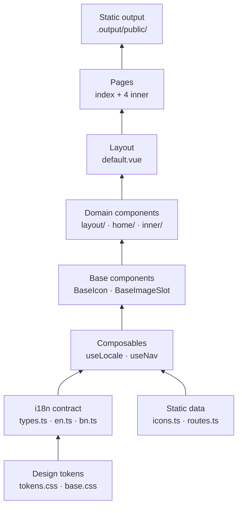

# Bangladesh Bank — Prototype HTML → Nuxt 4 SSG Migration Plan

> Companion to `architecture.md`. Generated from `PROMPT.md`.
> Checkpoint detail lives in `checkpoints/CP01-…` to `checkpoints/CP12-…`.

## 1. Summary

- **What:** the Bangladesh Bank public website (home + 4 inner views, English and Bangla).
- **From:** one 80 KB design-tool HTML prototype (`02-Design/Bangladesh Bank.html`) with a custom mini-template runtime.
- **To:** a modular, typed, static Nuxt 4 site (`Bangladesh Bank New Website/`), built with `npm run generate`.
- **Why:** the live site fails 3 WCAG criteria and has 9 audit issues; the prototype fixes the design, this plan makes it production code.
- **How:** 12 checkpoints. Each one ends green on the same Build → Validate → Test → Visual QA → Commit loop.

## 2. Guiding principles

1. **The prototype HTML is the specification.** Colors, spacing, fonts, radii, shadows, copy (en + bn), hover states and transitions are transcribed exactly. When a Nuxt convention conflicts with pixel fidelity, fidelity wins.
2. **Keep the data-driven pattern:** locale dictionary → typed props → simple components.
3. **One responsibility per file.** A repeated item becomes its own component.
4. **Every audit issue maps to a checkpoint** (Section 5).
5. **Each checkpoint ends in a buildable, testable, demo-able state.** Never advance on red.
6. **SSG only:** `ssr: true`, `nitro.preset: 'static'`. No backend, no server routes, no runtime fetch.
7. **Accessibility additions are invisible additions.** `aria-*`, landmarks, skip link, `tel:` links and focus styles are added without changing a default-state pixel (see Decision D1).

## 3. Prototype analysis

| Aspect | What the prototype does | What it becomes |
|--------|------------------------|-----------------|
| Template engine | Design-tool mini-template: `sc-for`, `sc-if`, `style-hover`, `{{ }}`, `<image-slot>` | Vue templates; `style-hover` → scoped `:hover`; `image-slot` → `BaseImageSlot.vue` |
| State | `view` (`home` \| `mp` \| `fin` \| `pub` \| `svc`) + `lang` (`en` \| `bn`), in memory, no URLs | `view` → real routes; `lang` → `useLocale()` over `useState` |
| Content | One `T = { en, bn }` dictionary, identical shape, nested `pages` map for 4 inner views (lines ~519–853) | `i18n/en.ts`, `i18n/bn.ts` typed by `LocaleContent` |
| View-model | A render function maps locale + icons + handlers into flat bindings | Composables + per-component props |
| Icons | `ICONS` path map + `svg(name, size)` | `data/icons.ts` + `BaseIcon.vue` |
| Chrome order | utility bar → masthead → sticky nav → ticker → content → footer | `layouts/default.vue` + 5 `layout/` components |
| Home | market cards, auctions, news, policy rates, reserves, modules, governor, services, hotlines, links | `components/home/*` |
| Inner views | One shared template driven by `L.pages[view]` (highlight, link groups, tables, sidebar) | `inner/InnerPage.vue` + 4 one-line pages |
| Palette | `#006A4E` (59×), `#4A4A4A`, `#E0E4E8`, `#F42A41`, `#EDF0F3`, `#E4F1EC`, `#0A3D2C`, `#5FBE9E`, `#F7FAF8`, `#DCEFE6` | `assets/css/tokens.css` (`--bb-*`) |
| Fonts | Inter (UI), JetBrains Mono (numbers) | `<link>` in `nuxt.config.ts`; `--bb-font`, `--bb-mono` |
| Gaps | 0 `aria-label`, 0 `tel:` links, 0 `@media` rules, 0 skip link | Added in CP07, CP09, CP11 (Decisions D1, D2) |

## 4. Target architecture

```
app/
├─ app.vue                      # <NuxtLayout><NuxtPage/></NuxtLayout>
├─ layouts/default.vue          # utility bar, masthead, nav, ticker, footer + <slot/>
├─ pages/                       # index.vue + monetary-policy / financial-system / publications / services
├─ components/
│  ├─ base/                     # BaseIcon, BaseImageSlot
│  ├─ layout/                   # LayoutUtilityBar, LayoutMasthead, LayoutPrimaryNav, LayoutTicker, LayoutFooter
│  ├─ home/                     # MarketCard, NewsList, PolicyRates, ModuleCard, Governor, Hotlines, …
│  └─ inner/                    # InnerPage, LinkGroup, DataTable, Sidebar
├─ composables/                 # useLocale.ts, useNav.ts
├─ data/                        # routes.ts, icons.ts
├─ i18n/                        # types.ts, en.ts, bn.ts
└─ assets/css/                  # tokens.css, base.css
```



## 5. Audit issue → checkpoint map

| # | Issue | Severity | WCAG | Fixing checkpoint(s) | How |
|---|-------|----------|------|----------------------|-----|
| 1 | No persistent navigation bar | High | — | **CP07**, CP11 | Sticky primary nav with all sections visible; skip-to-content link; `<nav aria-label>` |
| 2 | Fixed narrow page width (~843 px) | High | — | **CP02**, CP09, CP11 | `--bb-max: 1240px` + 40 px gutters; CSS Grid sections; responsive breakpoints in CP11 |
| 3 | Auto-rotating banner, no pause | High | 2.2.2 | **CP07** | Ticker gets a pause/play control, pauses on hover and focus, honors `prefers-reduced-motion` |
| 4 | Red/green card borders without meaning | High | 1.4.1 | **CP02**, CP09 | Semantic tokens: `--bb-green` for brand, `--bb-red` for alerts only |
| 5 | Governor section wasted space | Medium | — | **CP09** | Compact governor card from the prototype with message excerpt and descriptive link |
| 6 | Card icon/border misalignment | Medium | — | **CP09** | One `HomeModuleCard` component used by every card grid |
| 7 | Social icons without labels | Medium | — | **CP07** | Every icon-only link gets `aria-label`; `BaseIcon` is `aria-hidden` |
| 8 | Hotlines as bitmap images | High | — | **CP09** | HTML text + `<a href="tel:…">`, `role="region" aria-label="Emergency hotlines"`, bilingual labels |
| 9 | Decorative header, low-contrast search | Low | 1.4.3 | **CP07** | Masthead with real search input; placeholder contrast ≥ 4.5:1 |

## 6. The 12 checkpoints

| CP | Name | Goal (one sentence) | Depends on | Folder |
|----|------|---------------------|------------|--------|
| 01 | Scaffold and tooling baseline | An empty Nuxt 4 app builds to static HTML with lint, typecheck and Vitest green. | — | [CP01](../checkpoints/CP01-scaffold-and-tooling/) |
| 02 | Design tokens and base CSS | Every recurring color, font and width from the prototype is a `--bb-*` token. | 01 | [CP02](../checkpoints/CP02-design-tokens/) |
| 03 | i18n contract | `LocaleContent` types all prototype content; `en.ts` and `bn.ts` are transcribed exactly and cannot drift. | 01 | [CP03](../checkpoints/CP03-i18n-contract/) |
| 04 | `useLocale` and language switch | One composable holds the active language and switches content with no URL change. | 03 | [CP04](../checkpoints/CP04-use-locale/) |
| 05 | Icon system | Every prototype icon renders through `<BaseIcon name size>`. | 01 | [CP05](../checkpoints/CP05-icon-system/) |
| 06 | Routes and `useNav` | Each prototype view is a real, statically generated route with an active nav state. | 04 | [CP06](../checkpoints/CP06-routes-and-nav/) |
| 07 | Layout chrome | Every route shows the pixel-matched header, sticky nav, ticker and footer, with audit fixes 1, 3, 7, 9. | 02, 05, 06 | [CP07](../checkpoints/CP07-layout-chrome/) |
| 08 | Home — market data row | The market cards and auctions card match the prototype in both languages. | 07 | [CP08](../checkpoints/CP08-home-market-row/) |
| 09 | Home — remaining sections | The full home page matches the prototype, with audit fixes 4, 5, 6, 8. | 08 | [CP09](../checkpoints/CP09-home-sections/) |
| 10 | Shared inner-page system | 4 inner routes render from one `InnerPage.vue` driven by `L.pages[view]`. | 07 | [CP10](../checkpoints/CP10-inner-page-system/) |
| 11 | Full QA pass | 5 routes × 2 languages × 3 widths show 0 visual deltas and pass WCAG 2.1 AA checks. | 09, 10 | [CP11](../checkpoints/CP11-full-qa-pass/) |
| 12 | Production hardening and release | `.output/public/` is deployable and CI enforces every gate. | 11 | [CP12](../checkpoints/CP12-hardening-and-release/) |

Parallel lanes: CP02, CP03 and CP05 can run in parallel after CP01. CP08–09 and CP10 can run in parallel after CP07.

## 7. The validation loop (every checkpoint)

```
Build  →  Validate  →  Unit test  →  Visual QA vs prototype  →  Commit on green
  ↑                                                                   │
  └──────────────────────── fix on red ───────────────────────────────┘
```

| Step | Command / tool | Pass condition |
|------|----------------|----------------|
| Build | `npm run generate` | exit 0, files in `.output/public/` |
| Validate | `npx nuxi typecheck` · `npx eslint .` | 0 errors |
| Unit test | `npx vitest run` | all green |
| Visual QA | Chrome DevTools MCP: open prototype and `npx serve .output/public` side by side, screenshot, compare | 0 visible deltas, console 0 errors |
| Commit | `git commit` (only after explicit approval) | — |

**Never advance on red.**

## 8. Risks and decisions

| ID | Risk / decision | Impact | Mitigation / choice |
|----|-----------------|--------|---------------------|
| D1 | Fidelity vs accessibility: the prototype has no ARIA, skip link or `tel:` | Audit fixes need markup the design lacks | Add semantic and ARIA markup that does not change a default-state pixel. Skip link is visually hidden until focus. |
| D2 | The prototype has 0 `@media` rules | Mobile layout undefined | CP11 adds breakpoints at 768 px and 375 px; desktop (1280 px) stays pixel-exact. |
| D3 | Ticker pause control is a new visible element | Small visual change | Approved exception for WCAG 2.2.2; style it with existing tokens. |
| R1 | Bangla transcription errors | Wrong official content | Copy text programmatically from the `T` dict; key-parity test; native-speaker review in CP11. |
| R2 | `to: null` nav links (`about`, `fx`, `gsec`, `pay`) | Dead links confuse users | Keep non-navigating (faithful) and mark `aria-disabled="true"`; list for a later phase. |
| R3 | `support.js` / `image-slot.js` are design runtime | Accidental port of tool code | Do not port. `check-port.mjs` hook flags `sc-for`, `sc-if`, `style-hover`. |
| R4 | Visual diff by eye is subjective | Missed deltas | Fixed widths (1280 / 768 / 375) and a written per-section checklist in each `test-criteria.md`. |
| R5 | The prototype fails WCAG 1.4.3 twice: `#9aa39e` on white is 2.59:1 (8 uses), white on `#F42A41` is 4.00:1 | Fidelity conflicts with contrast | CP02 keeps exact values; CP11 asks the owner to approve a darker token as an exception. |
| R6 | `Bangladesh Bank New Website/app/` already holds draft code (27 components, 5 pages) | Plan could duplicate or ignore work | Each checkpoint marks matching files "Verify / rewrite"; its tests decide if the draft stays. Nothing is deleted. |
| R7 | Project `CLAUDE.md`, agents and skills point to `../01-Bangldesh-Bank-Refactor-Design/`, which does not exist | Agents read no design | CP01 changes the path to `../02-Design/`. |

## 9. Definition of done (full migration)

- [ ] 5 routes generate as static HTML: `/`, `/monetary-policy`, `/financial-system`, `/publications`, `/services`.
- [ ] Both languages switch on every route with no URL change.
- [ ] 0 visual deltas from the prototype at 1280 px.
- [ ] All 9 audit issues verified fixed.
- [ ] Lighthouse: Accessibility ≥ 95, Performance ≥ 90, SEO ≥ 95, Best Practices ≥ 95.
- [ ] CI runs lint, typecheck, Vitest and `generate` on every push.
- [ ] No design-tool syntax remains in `app/`.
