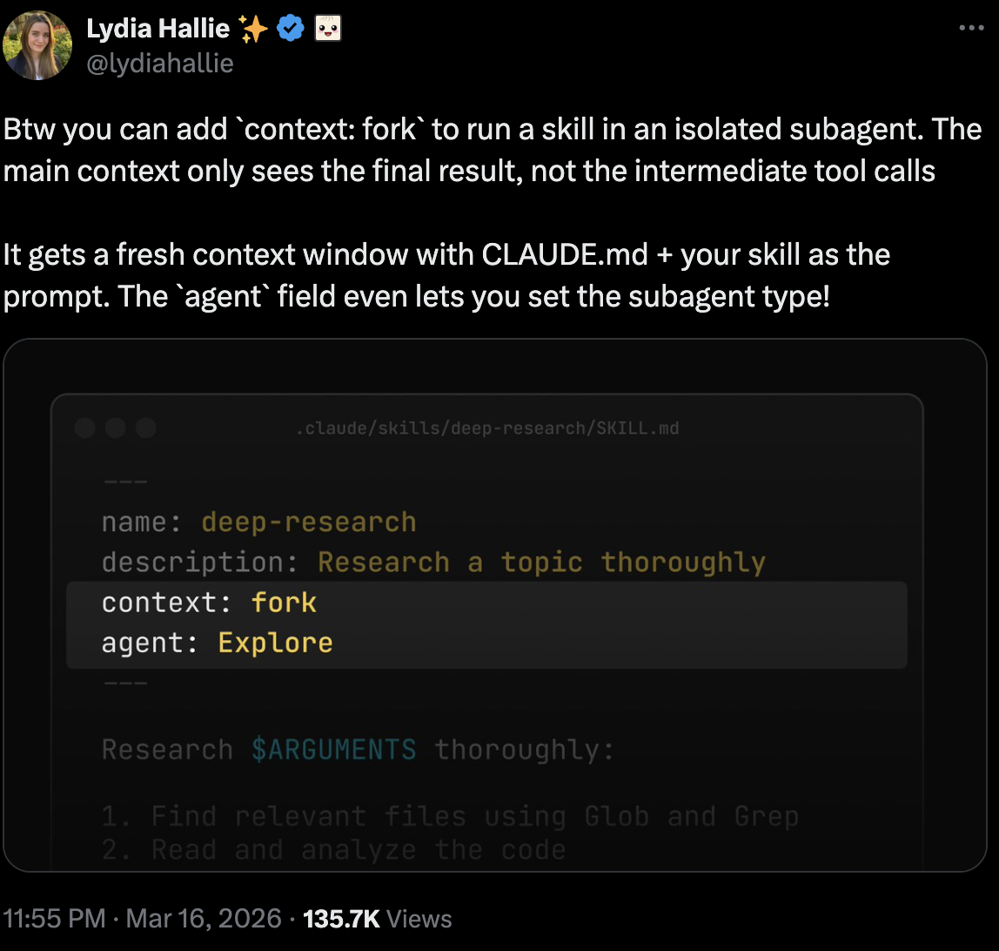
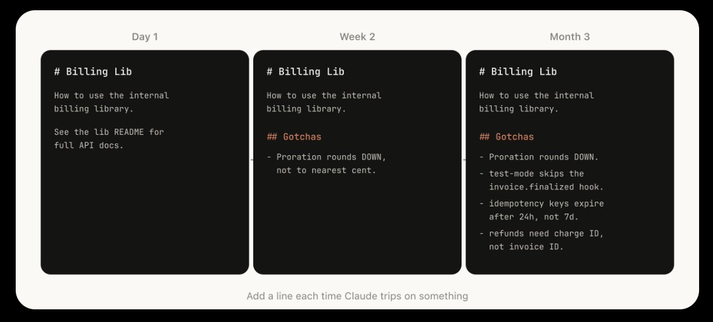
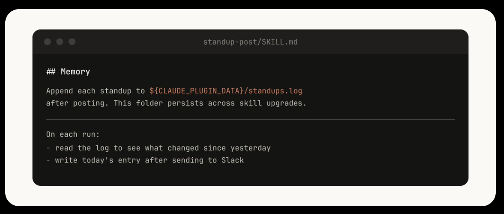
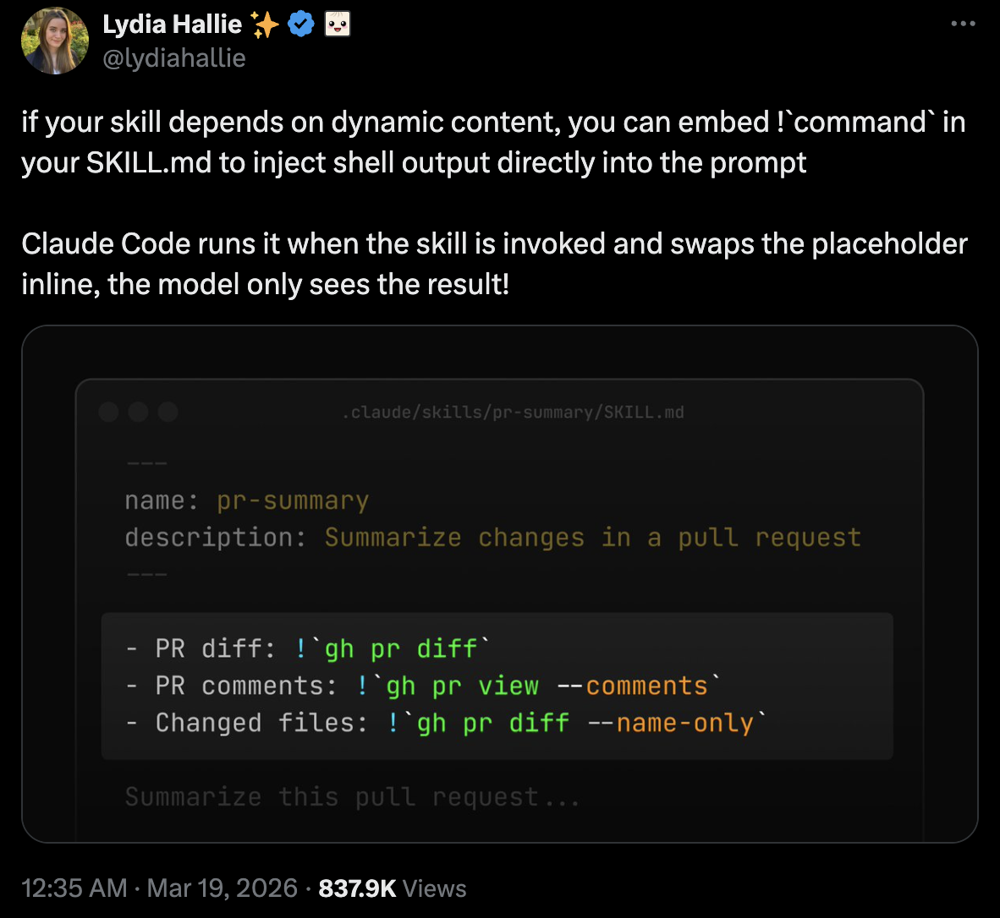
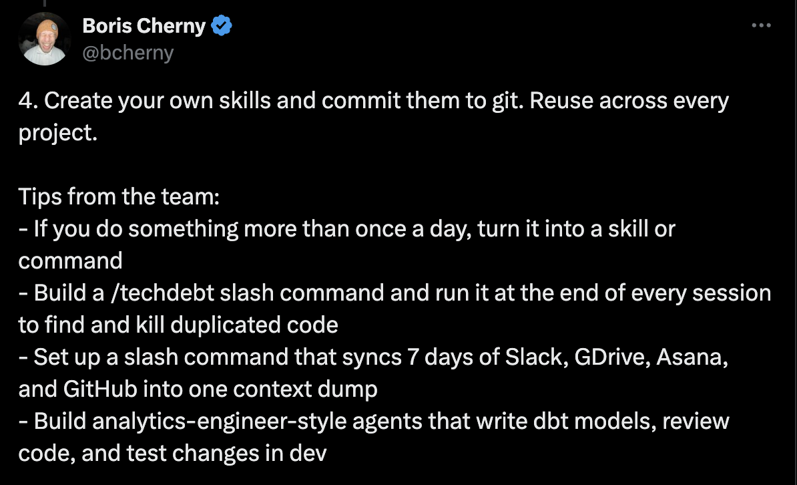

# Claude SKILLS

## Why Claude SKILLS Are Required

Skills address a fundamental need: **repeatable, user-invoked workflows with consistent output formats**.

### The Problem Skills Solve

Without skills, you'd repeatedly type complex instructions every time you need a specific task done:

```
"Review this code for bugs, security issues, and logic errors.
Focus on correctness, not style. Format the output with severity levels.
Include file references and suggested fixes..."
```

With skills, you simply type `/code-reviewer` — turning multi-paragraph instructions into a single command.

### Core Benefits

| Benefit | Description |
|---------|-------------|
| **Consistency** | Same output format every time — structured, scannable, actionable |
| **Efficiency** | Complex workflows reduced to a single slash command |
| **Institutional Knowledge** | Gotchas sections accumulate lessons learned over time |
| **Portability** | Share skills across projects and teams |
| **Dynamic Context** | Embed shell commands to inject runtime data into prompts |

---

## Skills vs Custom Agents: Key Differences

| Aspect | **Skills** | **Custom Agents** |
|--------|-----------|-------------------|
| **Invocation** | User-triggered via `/skill-name` | Claude-triggered via `Agent` tool |
| **Control** | You decide when to run | Claude decides when to spawn |
| **Purpose** | Repeatable tasks with consistent format | Autonomous subtasks or parallel work |
| **Context** | Runs in main context (or isolated subagent) | Always runs in isolated subprocess |
| **Persistence** | Can store data, templates, scripts | Stateless per invocation |
| **Scope** | Single focused task | Multi-step exploration/planning |
| **Location** | `.claude/skills/` directory | `.claude/agents/` directory |

### When to Use Each

**Use a Skill when:**
- You want to invoke the same workflow repeatedly
- You need consistent, structured output
- The task is user-initiated (you decide when)
- Examples: `/code-reviewer`, `/changelog`, `/techdebt`

**Use an Agent when:**
- Claude should autonomously decide when to act
- Work can be parallelized or delegated
- Tasks require exploration before action
- Examples: `code-quality-auditor`, `Explore`, `Plan`

### Practical Example

**Skill** (`/code-reviewer`): You invoke it when *you* want a code review — it follows a defined protocol and outputs a structured report.

**Agent** (`code-quality-auditor`): Claude *automatically* spawns it after writing significant code — it decides when the context warrants review.

Think of it as:
- **Skills** = Tools you wield
- **Agents** = Assistants Claude delegates to

---

## Hands-On: Create Your First Skill

### Exercise Prompt

Copy and paste this prompt to Claude to create a learning skill:

```
Create a skill called "explain-code" that helps developers understand unfamiliar code.

Requirements:
1. Create the skill in `.claude/skills/explain-code/SKILL.md`
2. The skill should:
   - Accept a file path or code block as input
   - Explain what the code does in plain English
   - Identify the programming patterns used
   - List any dependencies or imports
   - Highlight potential gotchas or tricky parts
   - Suggest related documentation to read

3. Output format should be structured with these sections:
   - Summary (2-3 sentences)
   - Step-by-Step Breakdown
   - Patterns Used
   - Dependencies
   - Watch Out For (gotchas)
   - Learn More (documentation links)

4. Include a Gotchas section in the skill itself for common issues

Make sure the skill follows the standard SKILL.md frontmatter format with name and description.
```

### After Creating the Skill

Test your new skill by running:
```
/explain-code src/app.js
```

Or for any code file in your project:
```
/explain-code path/to/any/file.py
```

---

## References

[Claude Documentation](https://code.claude.com/docs/en/skills#create-your-first-skill)


## Complete Skill Structure

Here's the recommended folder structure for organizing a skill:

```
my-skill/
├── SKILL.md           # Main instructions (required)
├── template.md        # Template for Claude to fill in
├── examples/
│   └── sample.md      # Example output showing expected format
└── scripts/
    └── validate.sh    # Script Claude can execute
```


## Suggested Practices for Using SKILLS

### 1. Use context: Run skills in isolated subagents

Fork to run a skill in an isolated subagent — main context only sees the final result, not intermediate tool calls. The agent field lets you set the subagent type.



### 2. Skills are folders, not files

Organize skills with `references/`, `scripts/`, `examples/` subdirectories for progressive disclosure.

### 3. Build a Gotchas section in every skill

Maintain a Gotchas section with highest-signal content. Add Claude's failure points over time to help users avoid common pitfalls.



### 4. Store data within skills

Skills can include a form of memory by storing data within them. You can store data in anything as simple as an append-only text log file or JSON files, or as complex as a SQLite database.



### 5. Embed shell commands in SKILL.md

Embed `!command` in SKILL.md to inject dynamic shell output into the prompt. Claude runs it on invocation and the model only sees the result.



### 6. Where to use SKILLS/Commands effectively

If you do something more than once a day, turn it into a skill or command — build /techdebt, context-dump, or analytics commands.


---