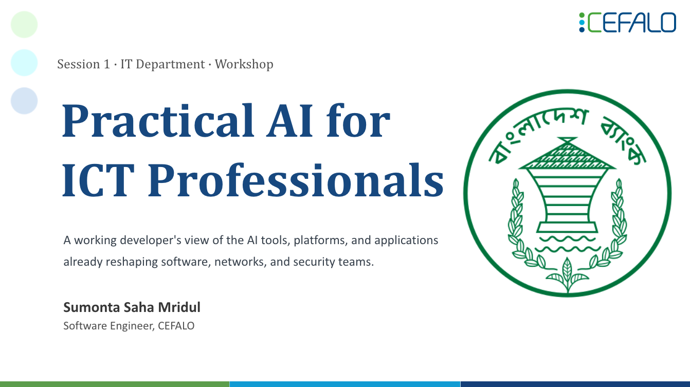

# AI Workshop — Bangladesh Bank ICT Professionals



**Slides:** [AI Workshop Presentation](https://docs.google.com/presentation/d/1tBhYldQMoB3AF6eL0WOoKfQORcw_NufeMqcWgAwo8Ps/edit?usp=sharing)

---

## Overview

This repository contains all materials, demos, and hands-on exercises from the **AI Workshop for Bangladesh Bank ICT Professionals** — covering AI tools, agentic coding workflows, prompt engineering, security, data analysis, and full-stack development with modern AI coding assistants.

---

## Repository Structure

| Folder | Description |
|--------|-------------|
| [`00-slides/`](#00-slides) | Workshop presentation decks (PPTX) and demo playbooks |
| [`01-Bangldesh-Bank-Refactor-Design/`](#01-design-source) | Source HTML design — the original Bangladesh Bank website design (source of truth) |
| [`02-Bangladesh-Bank Website Refactor/`](#02-website-refactor) | Intermediate refactor attempt of the Bangladesh Bank website |
| [`03-Bangladesh-Bank-New-Website/`](#03-new-website) | Full Nuxt 4 static site — faithful port of the design into modular Vue components |
| [`04-Bangladesh-Bank-ChatBot/`](#04-chatbot) | AI chatbot script and prompt for Bangladesh Bank |
| [`05-claude-code-intro/`](#05-claude-code-intro) | Introduction to Claude Code — getting started materials and reference HTML |
| [`06-claude-workshop/`](#06-claude-workshop) | Full Claude Code workshop with a Doctor-Patient app and 13 lesson modules |
| [`06-claude-workshop-no-guard/`](#06-claude-workshop-no-guard) | Same workshop without safety guardrail configuration (comparison variant) |
| [`07-cursor-workshop/`](#07-cursor-workshop) | Cursor AI workshop — NestJS + Next.js Task Manager project |
| [`08-data-analysis/`](#08-data-analysis) | AI-powered data analysis demo using General Ledger data |
| [`09-codex-workshop/`](#09-codex-workshop) | OpenAI Codex workshop — 8 chapters from project instructions to shipping |
| [`10-cursor-workshop/`](#10-cursor-workshop) | Cursor workshop variant with NetDevOps demo |
| [`11-claude-networking-security/`](#11-networking-security) | Networking & security demos with Claude Code |
| [`Agreement/`](#agreement) | Participant agreement / CV document |
| [`others/`](#others) | Miscellaneous resources |

---

## Folder Details

### 00-slides

Workshop slide decks covering all topics in the program.

| File | Topic |
|------|-------|
| `AI-Cloud-DevOps.pptx` | AI in Cloud & DevOps workflows |
| `AI-Domain.pptx` | AI applied to domain-specific problems |
| `AI-Security-Networking.pptx` | AI for Security & Networking |
| `AI-Tools-Frameworks-Platforms.pptx` | Overview of AI tools, frameworks, and platforms |
| `Data-Analysis-AI.pptx` | Data analysis with AI assistants |
| `Developer-Productivity.pptx` | Boosting developer productivity with AI |
| `Developer-Tools-Deep-Dive.pptx` | Deep dive into AI developer tools |
| `Prompting-Power.pptx` | Prompt engineering techniques |
| `Security-Guardrails.pptx` | Safety and guardrails in AI systems |

**Demo playbooks & reports (HTML):**
- `antigravity-demo-report.html` — Antigravity AI demo report
- `codex-demo-playbook.html` — Step-by-step Codex live demo guide
- `codex-vs-claude-code.html` — Side-by-side comparison of Codex vs Claude Code
- `cursor-demo-report.html` — Cursor AI demo report

---

### 01-Design Source

`01-Bangldesh-Bank-Refactor-Design/`

The **original single-file HTML design** for the Bangladesh Bank website — the design specification and source of truth for all porting work.

| File | Purpose |
|------|---------|
| `Bangladesh Bank.html` | Rendered design + all content/data (`T` dict, view logic) |
| `support.js` | Design tool's React runtime — not site code, not ported |
| `image-slot.js` | Drag-drop placeholder web component |

---

### 02-Website Refactor

`02-Bangladesh-Bank Website Refactor/`

Intermediate refactor of the Bangladesh Bank website showing staged work output:

- `01-Finding/` — Initial discovery / audit
- `01-report/` — Report artifacts
- `02-Planning/` — Architecture planning docs
- `04-Review/` — Code review output
- `05-Qa/` — QA results
- `06-deploy/` — Deployment artifacts
- `backup.js` — Backup of a design script

---

### 03-New Website

`03-Bangladesh-Bank-New-Website/`

**Production-quality Nuxt 4 static site** — a pixel-faithful port of the Bangladesh Bank design into modular Vue components with scoped CSS, design tokens, and bilingual (EN/BN) i18n support.

**Tech stack:** Nuxt 4 · Vue 3 · TypeScript · SSG (`npm run generate`)

**Key directories:**
```
app/
├── components/     # Vue components by domain (home/, layout/, inner/, base/)
├── pages/          # Route pages (/, /monetary-policy, /financial-stability, etc.)
├── composables/    # useLocale() and other composables
├── assets/css/     # tokens.css — design token definitions
└── i18n/           # en.ts + bn.ts content files
```

**Quick start:**
```bash
npm install
npm run dev       # http://localhost:3000
npm run generate  # static output → .output/public/
```

---

### 04-ChatBot

`04-Bangladesh-Bank-ChatBot/`

AI chatbot proof-of-concept for Bangladesh Bank:

- `chatbot-script.js` — Chatbot implementation script
- `PROMPT.md` — System prompt / persona definition
- `prothomalo-benchmark-report.html` — Benchmark report
- `prothomalo-security-report.html` — Security audit report

---

### 05-Claude Code Intro

`05-claude-code-intro/`

Getting-started materials for Claude Code:

- `claude-code-intro.html` — Interactive intro reference page
- `workshop-reference.html` — Quick-reference cheat sheet for workshop participants

---

### 06-Claude Workshop

`06-claude-workshop/`

**Full Claude Code workshop** built around a Doctor-Patient Management System.

**App tech stack:** Next.js 16 · Prisma · SQLite · Ant Design · Tailwind CSS

**13 workshop modules in `/lessons`:**

| # | Module |
|---|--------|
| 01 | CLAUDE.md Patterns |
| 02 | Full-Stack App Operations |
| 03 | Claude Skills |
| 04 | Custom Agents |
| 05 | Agent Tuneup |
| 06 | Claude Hooks |
| 07 | Claude Settings |
| 08 | MCP Server Integration |
| 09 | Combining Features |
| 10 | Claude Commands |
| 11 | Spec-Driven Development |
| 12 | Frontend Design with Claude Code |
| 13 | Claude Code Test Automation |

**Quick start:**
```bash
cd doctor-patient-app
pnpm install
pnpm exec prisma migrate dev
pnpm exec prisma db seed
pnpm dev   # http://localhost:3000
```

---

### 06-Claude Workshop No Guard

`06-claude-workshop-no-guard/`

Identical workshop content as `06-claude-workshop/` but without hook-based safety guardrails — used to demonstrate the difference between guarded and unguarded Claude Code sessions.

---

### 07-Cursor Workshop

`07-cursor-workshop/`

**Cursor AI workshop** — build a full-stack Task Manager from scratch.

**Tech stack:** NestJS · Next.js 14 · TypeORM · PostgreSQL · Redis · Docker

**Quick start:**
```bash
docker-compose up -d
cd backend && npm install && npm run migration:run && npm run seed && npm run start:dev
cd frontend && npm install && npm run dev
```

- Backend API: `http://localhost:3000/api/docs` (Swagger)
- Frontend: `http://localhost:3001`

---

### 08-Data Analysis

`08-data-analysis/`

AI-assisted data analysis demo using Bangladesh Bank financial data.

| File | Purpose |
|------|---------|
| `General-Ledger.xlsx` | Sample General Ledger dataset |
| `PROMPT.md` | Analysis prompts used with AI assistants |
| `prothomalo-benchmark-report.html` | Benchmark analysis report |
| `prothomalo-security-report.html` | Security-focused analysis report |

---

### 09-Codex Workshop

`09-codex-workshop/`

**OpenAI Codex workshop** — 8 progressive chapters from project setup to shipping.

**8 chapters in `/lessons`:**

| Chapter | Topic |
|---------|-------|
| 01 | Project Instructions (`AGENTS.md`) |
| 02 | Setup & Sandboxing |
| 03 | Plan Then Edit |
| 04 | Code Review |
| 05 | Testing & Verification |
| 06 | Working with Existing Code |
| 07 | Frontend & Browser QA |
| 08 | Shipping Workflow |

---

### 10-Cursor Workshop

`10-cursor-workshop/`

Cursor workshop variant with additional resources:

- `examples/` — Reference `.cursorrules` configurations
- `resources/` — Templates and reference materials
- `netdevops-demo/` — Network DevOps automation demo
- `01-Report.html`, `Backup.html`, `Bangladesh Bank — Redesign.html` — Demo artifacts

---

### 11-Networking Security

`11-claude-networking-security/`

Claude Code applied to networking and security scenarios — demos, prompts, and reports.

---

## Workshop Facilitator

**Sumonta Saha Mridul** — [sumontasaha80@gmail.com](mailto:sumontasaha80@gmail.com)
